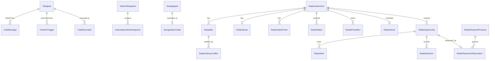

## Database result

No model, migration, schema, or production data change is part of Release 0.

The local ARC 2.0 branch now exposes 47 Django models through 27 numbered
migration files plus the migration package initializer. Migration `0024` adds
neutral canonical instruments, provider aliases, and nullable mappings from
`TipSignal` and `RadarInstrument`. Migration `0025` adds common opportunities,
immutable evidence revisions, and status history. Migration `0026` adds
normalized fundamentals, financial results, news, corporate actions, and
versioned stock scores. None has been deployed. The history
includes parallel `0012` names and subsequent convergence. Every migration
must be tested from both an empty database and a production-like copy.

Both migrations pass empty test-database creation and were applied to the
existing local SQLite database. A reconciliation dry run found 71,898 unmapped
radar instruments. The apply command is bounded to 500 rows by default, accepts
an explicit limit from 1 through 5,000, and is restartable. No local identity
backfill was applied during this validation.

## Current model groups

### Signals, ingestion, and execution

* `CanonicalInstrument`
* `InstrumentAlias`
* `UnifiedOpportunity`
* `OpportunityRevision`
* `OpportunityStatusEvent`
* `StockFundamentalSnapshot`
* `StockFinancialResult`
* `StockNewsItem`
* `StockCorporateAction`
* `StockScoreSnapshot`
* `TipSignal`
* `ChatMessage`
* `ChartinkTrigger`
* `TradeExecution`
* `DhanOrderEvent`
* `AppSetting`

Important relationships:

* A chat message may link to one signal.
* A scanner trigger may link to one promoted signal.
* A signal may have many protected trade executions.
* Order events are not directly constrained to an execution.

### Index analytics

* `IndexOISnapshot`
* `IndexOptionStrikeSnapshot`
* `IndexOptionCandle`

Important relationships:

* A snapshot has many strike snapshots.
* Candles repeat contract identity in scalar fields rather than referencing an instrument.

### Stock reference, candles, and downloads

* `TrackedStock`
* `StockEquityCandle`
* `StockOptionCandle`
* `DownloadJob`

These models use symbol-based identity. Download jobs describe work but do not have foreign keys to an instrument or dataset manifest.

### Broker performance

* `BrokerPnlEntry`
* `BrokerPeriodSummary`

Broker rows retain raw broker symbols and normalized fields. They are valuable for reconciliation, but no canonical broker-instrument alias table exists.

### Shortlist and swing

* `DailyPick`
* `SwingSignal`
* `SwingOptionTrade`

`SwingOptionTrade` has a one-to-one relationship with `SwingSignal` and repeats option contract identity.

### Closing auction

* `CasAuctionEvent`

The event stores security ID, index name, and a generic JSON payload.

### Radar and personal workspace

* `RadarInstrument`
* `RadarBar`
* `RadarQuote`
* `RadarOptionPoint`
* `RadarWatch`
* `RadarWorkspace`
* `RadarNotificationRoute`
* `RadarPriceAlert`
* `RadarSector`
* `RadarOpportunity`
* `RadarAlert`
* `RadarDecision`
* `RadarWorker`
* `RadarAssistantSnapshot`
* `RadarResearchProtocol`
* `RadarResearchObservation`
* `RadarCatalyst`
* `RadarHistoryConflict`

The radar group has the strongest relational integrity in the application:

* Instrument identity is unique by segment and security ID.
* Bars and option points are unique by instrument and timestamp.
* Quotes are one-to-one with instruments.
* Watches are unique by user and instrument.
* Opportunities protect their selected option contract.
* Research observations are one-to-one with opportunities and link to a protocol.
* Repairs are represented by explicit conflict records.

## Current relationship sketch

## Canonical identity gaps

### Instrument duplication

The same equity or option may appear in:

* `RadarInstrument`
* `TrackedStock`
* `TipSignal`
* `IndexOptionStrikeSnapshot`
* `IndexOptionCandle`
* `StockEquityCandle`
* `StockOptionCandle`
* `SwingOptionTrade`
* `BrokerPnlEntry`
* `CasAuctionEvent`

Names, symbols, security IDs, segments, expiry encodings, and strike representations are not normalized consistently.

### Trade concept overlap

The system distinguishes some, but not all, of these concepts:

* External message.
* Signal or idea.
* Strategy opportunity.
* User decision.
* Paper position.
* Broker order.
* Broker fill.
* Trade execution.
* Journal record.
* Imported broker P&L row.

`RadarOpportunity` currently carries both opportunity and paper-position fields. `TradeExecution` represents a broker-linked journal entry. `DhanOrderEvent` is a generic event log. ARC 2.0 should preserve these records while clarifying boundaries.

### Configuration and status overlap

`AppSetting` stores:

* Dhan credentials.
* Telegram token.
* Poll intervals.
* Engine enabled state.
* Worker and collector status JSON.
* Deployment commit.
* VM synchronization state.

The table is useful, but keys and values are not schema-validated at the database layer.

## Data volume and migration risk

The stock candle tables can contain millions of rows. A prior production coverage query operated over approximately 13.4 million candles. This changes the migration strategy:

* Do not add a populated non-null foreign key in one blocking migration.
* Do not rewrite large candle tables during a web deployment.
* Add nullable columns or mapping tables first.
* Backfill in bounded, restartable batches.
* Add indexes concurrently where PostgreSQL support and Django migration mechanics permit.
* Validate counts, uniqueness, unresolved mappings, and query plans before enforcing constraints.

## Canonical model direction

The additive identity foundation is implemented locally. High-volume backfills
and removal of legacy scalar identifiers remain future phases.

### Instrument

Implemented direction:

* Use neutral `CanonicalInstrument` records rather than making radar ownership
  the application-wide identity.
* Preserve `(exchange_segment, security_id)` as the unique provider identity.
* Store normalized underlying, instrument kind, expiry, strike, option side,
  lot size, and active state.
* Keep provider aliases separately with a unique provider, value, and segment
  identity.
* Map current low-volume `TipSignal` and `RadarInstrument` rows through nullable
  protected references.

### Market observation

Do not force all quote, bar, OI, and candle shapes into one table. Standardize their envelope:

* Instrument reference.
* Provider.
* Provider timestamp.
* Received timestamp.
* Interval.
* Completeness.
* Repair or backfill status.
* Provenance metadata.

### Opportunity and decision

Use the radar pattern:

* Versioned strategy opportunity.
* Immutable evidence.
* User decision with actor and timestamp.
* Separate paper or live execution record.

### Broker order and fill

Future typed records should preserve the raw broker payload while exposing:

* Broker.
* Account.
* Client correlation ID.
* Broker order ID.
* Order side and type.
* Requested and filled quantity.
* Prices.
* Status.
* Actor or engine principal.
* Timestamps.

## Incremental migration sequence

### Phase A: mapping without schema replacement

* [x] Build dry-run and explicit-apply reconciliation.
* Measure duplicate and unresolved identities.
* [x] Define canonical keys and alias rules.
* Add tests for corporate-action and expiry behavior.

### Phase B: additive identity tables

Implemented locally, not deployed:

* [x] Add canonical instrument and alias structures.
* [x] Add nullable references from low-volume tables first.
* Dual-read and compare before switching.

### Phase C: high-volume backfill

* Backfill candle references in bounded batches.
* Record checkpoints and errors.
* Keep existing scalar identity columns during verification.
* Validate on a production-sized copy.

### Phase D: constraints and cleanup

* Enforce only after zero unresolved mappings.
* Keep rollback-compatible columns for at least one release.
* Remove duplication only in a separately approved migration.

## Rollback requirements

Every schema release must include:

* Pre-migration backup or point-in-time recovery confirmation.
* Forward and rollback query plans.
* Row-count and checksum validation.
* A maximum lock-time budget.
* A tested application rollback that still understands the schema.
* A worker compatibility check for both App Service and VM code.
* A rule that the deployed marker is not advanced until migrations and checks pass.

## Release 1 recommendation

Release 1 can deliver meaningful value without a database migration:

* Protect routes.
* Introduce task-oriented navigation.
* Add manual-execution policy gates using existing settings accessors.
* Add read-only health and provenance views.
* Add canonical-identity reports.

The first schema proposal should be a separate, reviewed change after these boundaries are stable.
