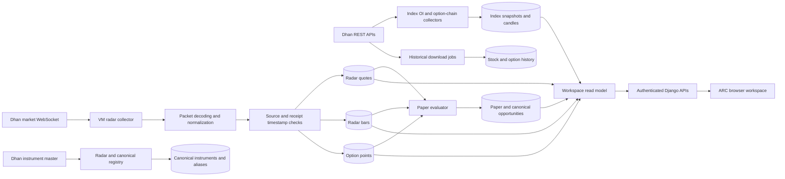

## Architecture goals

The live-data architecture must provide attributable, correctly timestamped
market evidence without creating a second Dhan integration or allowing stale
data to become trade-ready.

The existing VM collector remains the owner of the Dhan market WebSocket. The
App Service remains the owner of HTTP rendering and APIs. PostgreSQL remains
the shared durable handoff.

## Production data flow

## Runtime ownership

| Runtime | Owns | Does not own |
|---|---|---|
| Static-IP VM token service | Dhan token renewal and shared publication | Web serving, migrations, or duplicate renewal |
| Static-IP VM radar collector | Dhan WebSocket, subscriptions, packet liveness, quotes, bars, and option points | Broker order placement |
| Static-IP VM evaluator | Deterministic paper setups, lifecycle, research snapshots, and progress leases | Live market collection |
| Static-IP VM delivery worker | Deduplicated paper alerts | Signal generation or broker orders |
| App Service | Authenticated pages, APIs, static assets, migrations, index collectors, and read models | Dhan token renewal |
| GitHub Actions | Test, package, deploy, Kudu verification, and commit-specific warm-up | Runtime trading decisions |
| PostgreSQL | Domain records, worker leases, deployment handoff, and provider evidence | Secret presentation |

## Instrument identity

### Provider identity

Every Dhan request uses exchange segment and security ID. Display symbols are
never sufficient for subscriptions, historical requests, or broker records.

### Canonical identity

`CanonicalInstrument` is the cross-provider identity. It preserves:

* Canonical and display symbols
* Instrument kind
* Exchange segment
* Security ID
* Underlying
* Expiry
* Strike
* Option type
* Lot size

Provider aliases are unique within provider and exchange segment. Option
aliases include underlying, expiry, strike, and side so contracts for one
underlying cannot collide.

## WebSocket lifecycle

The collector must:

1. Authenticate with the current shared Dhan token.
2. Acquire the single collector lease.
3. Load active subscriptions from canonical provider identities.
4. Partition subscriptions within provider connection and instrument limits.
5. Decode binary packets and reject malformed identities or values.
6. Preserve provider and receipt timestamps.
7. Treat any valid decoded packet as socket liveness.
8. Apply quote freshness separately from connection liveness.
9. Deduplicate observations by instrument and source timestamp.
10. Reconnect with bounded backoff and preserve collection-only ownership.
11. Recover subscriptions after token rotation, connection loss, or process
    restart.

Official Dhan limits permit five connections with 5,000 instruments on each.
ARC should not subscribe to the entire cash master by default. Live
subscriptions belong to F&O research, selected watchlists, scanners, and
operator-visible workspaces.

## Timestamp and freshness contract

Every live observation must expose:

| Field | Meaning |
|---|---|
| Provider | The system that produced the observation |
| Instrument | Canonical and provider identity |
| Source timestamp | Time assigned by the provider |
| Received timestamp | Time ARC decoded or received the observation |
| Data age | Current time minus source timestamp |
| Receipt delay | Received timestamp minus source timestamp |
| Freshness state | Current, delayed, stale, future, or unavailable |
| Market state | Pre-open, open, closed, holiday, special session, or provider unavailable |

### Trading eligibility

Trading and paper-entry eligibility use strict source freshness. Socket
liveness does not make an old quote trade-ready.

### Closed markets

Outside market hours ARC displays:

* Market-closed state
* Last traded value
* Actual source timestamp
* Age

It does not display a green live label merely because the worker is connected.

## Historical architecture

Historical requests are explicit jobs rather than web-request side effects.

Each job records:

* Instrument and provider identity
* Interval
* Requested range
* Attempt state
* Rows written
* Failure detail
* Completion time

Duplicate candles are rejected by instrument, interval, and timestamp
identity. Missing intervals remain missing. ARC can aggregate larger bars only
when the required lower-interval bars are complete.

## Browser delivery

The current browser workspace uses versioned authenticated polling. Polling is
acceptable while:

* Responses remain within measured query budgets.
* Payloads contain freshness metadata.
* Browser errors remain visible.
* Requests do not multiply provider calls.

A server-sent event or WebSocket browser channel is a later optimization. It
must read normalized stored observations and must not create another direct
Dhan subscription per browser.

## Recovery

| Failure | Expected behavior |
|---|---|
| Dhan socket disconnect | Mark reconnecting, preserve collector ownership, reconnect, and restore subscriptions |
| Stale provider timestamps | Keep socket alive but mark quotes unavailable for trade readiness |
| Token rotation | Sole token owner publishes the token; dependent workers reconnect |
| VM restart | Systemd restarts services; supervisor staggers memory-heavy children |
| Evaluator long scan | Progress heartbeats renew the lease every five instruments and between research stages |
| App Service deployment | Kudu must report a new successful deployment; web health must report the exact commit |
| Provider outage | Preserve last observation with stale or unavailable status; do not fabricate replacement data |
| Database interruption | Close stale connections, retry only bounded idempotent work, and surface failure |

## Current verified coverage

* 218 active F&O equities
* 74,699 current option reference rows
* 314,001 radar bars
* 233 current quote records
* 190 option-point records
* 23,004 index OI snapshots
* 9,705,592 index strike snapshots
* 692,868 index option candles
* Active collector, evaluator, and delivery leases
* Immutable radar research protocol v22

## Remaining architecture work

* Populate canonical identities and aliases.
* Load the reviewed tracked-stock universe.
* Activate bounded stock historical jobs.
* Add exchange-aware identity to stock-history tables before full BSE history.
* Synchronize parsed tips and active radar setups into canonical opportunities.
* Configure approved global, macro, flow, fundamental, event, news, and AI
  providers.
* Add an exchange calendar for holidays and special sessions.
* Evaluate server push only after current polling metrics justify it.
