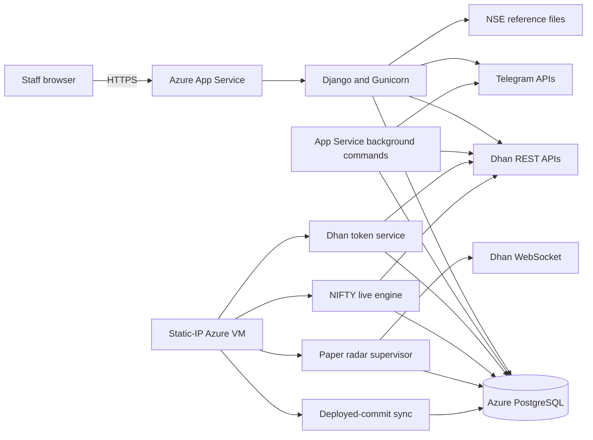
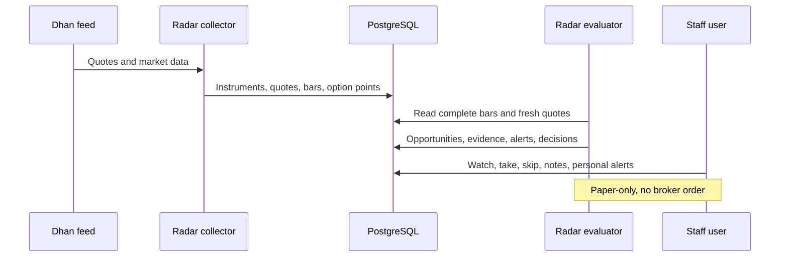
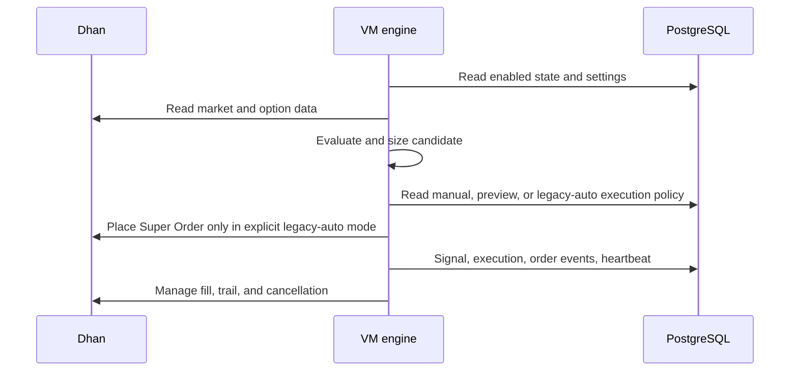
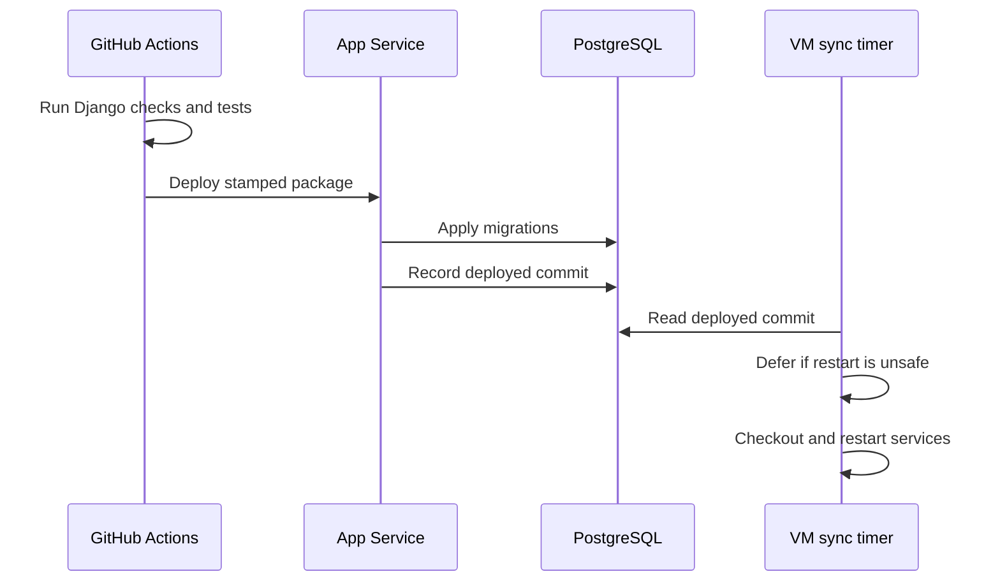

## Current architecture

ARC is a Django modular monolith deployed across Azure App Service and one static-IP Azure VM. Both hosts use shared PostgreSQL.

## Runtime ownership

| Runtime | Owns | Must not own |
|---|---|---|
| App Service web | HTTP, templates, APIs, admin, static assets | Dhan token renewal or order-capable live engine |
| App Service commands | Migrations, OI, shortlist, swing, CAS, optional Telegram | Static-IP-only broker execution |
| VM token service | Sole Dhan token renewal | Web serving or migrations |
| VM NIFTY service | Legacy live engine and position management | Schema changes |
| VM radar service | Quote collection and paper evaluation | Broker orders |
| VM sync timer | Follow post-migration deployed commit | Advance beyond deployment marker |
| GitHub Actions | Test, package, deploy | Change VM code before App Service migration succeeds |

## Application modules

| Module | Responsibility |
|---|---|
| `access.py` | Staff enforcement for unsafe legacy HTTP methods |
| `views.py` | Legacy signal, Telegram, scanner, OI, order, journal, archive, and NIFTY pages |
| `radar_views.py` | Staff-only radar UI and personal mutations |
| `radar.py` | Deterministic paper opportunity lifecycle |
| `radar_feed.py` | Market collection and quote/bar persistence |
| `radar_workspace.py` | Stock-centric workspace read model |
| `radar_models.py` | Radar, personal workspace, worker, and research persistence |
| `command_centre.py` | Unified index, breadth, regime, scenario, opportunity, position, and health read model |
| `instrument_identity.py` | Canonical instrument registration, alias conflict protection, and resolution |
| `opportunities.py` | Cross-source opportunity fingerprints, evidence revisions, and guarded lifecycle |
| `stock_intelligence.py` | Normalized stock evidence, technical metrics, and versioned explainable scores |
| `services.py` | Dhan credentials, quote, order, scoring, and legacy synchronization services |
| `execution_policy.py` | Manual-default execution boundary and explicit legacy compatibility mode |
| `live_engine.py` | NIFTY evaluation, observed entries, and legacy-gated automatic execution |
| `operations_health.py` | Secret-free deployment, provider, worker, execution-policy, and engine health |
| `performance.py` | Explicit database-query budgets for critical operator pages |
| `index_oi_services.py` | Index chain and candle collection |
| `stock_data.py` | Instrument master and historical stock/option collection |
| `shortlist.py` | Daily stock candidate model |
| `swing.py` and related modules | Strength-dip stock and option paper strategies |
| `cas_nowcast.py` | Closing auction stream and nowcast |
| `research_views.py` | Production rendering of approved research tables |

## Primary data flows

### Paper radar

### Legacy NIFTY engine

This flow is a legacy compatibility path. The default local Release 1 policy is
manual: valid entries are recorded for review and existing live positions
continue to be protected. Preview mode blocks all broker mutations. Only the
explicit `legacy_auto` compatibility mode permits automatic entries.

### Deployment synchronization

## Target ARC 2.0 boundaries

* Identity: canonical instruments and aliases.
* Market data: provider, timestamp, freshness, and observation values.
* Ideas: external messages, scans, manual tips, and scoring.
* Opportunities: versioned strategy findings and evidence.
* Decisions: authenticated user intent.
* Portfolio: paper positions, broker orders, fills, and journal.
* Research: protocols, runs, manifests, and approved publications.
* Operations: secrets, workers, deployment, health, and reconciliation.

## Non-negotiable invariants

* Only one Dhan token renewer exists.
* App Service owns migrations.
* The VM never runs code beyond the deployed post-migration commit marker.
* Paper radar never places a broker order.
* New ARC 2.0 execution remains manual.
* Market data always exposes source and freshness.
* Research workspace files are not production runtime dependencies.
* Repairs and conflict acceptance remain auditable.

## Delivery status

The [release dashboard](./release-dashboard.md) is the permanent source of truth
for implementation, test, and deployment status. Architecture descriptions do
not imply that a change has been deployed.

## Related documents

* [Existing system audit](./01-existing-system-audit.md)
* [Architecture assessment](./03-architecture-assessment.md)
* [Database](./database.md)
* [API](./api.md)
* [Decisions](./decisions.md)
